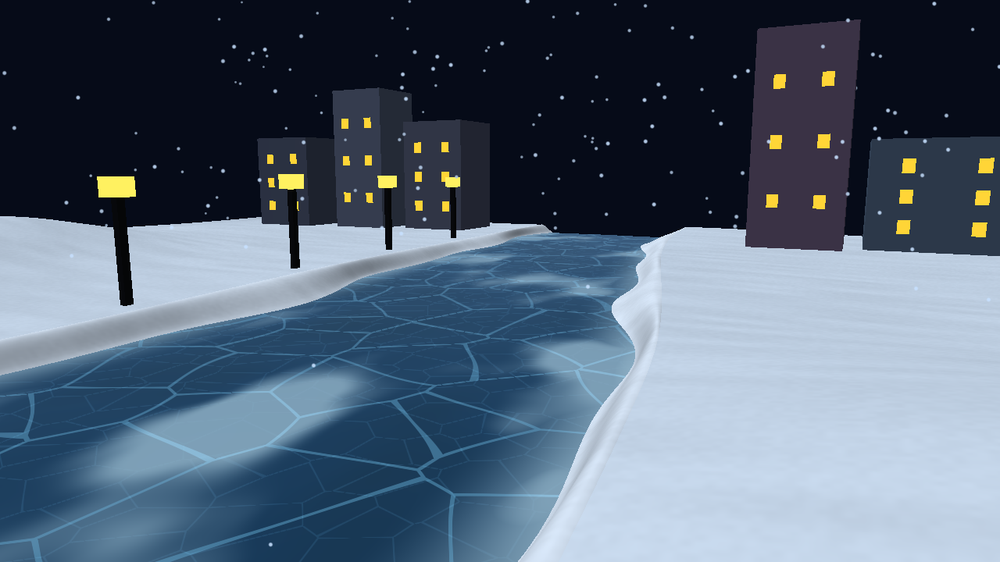
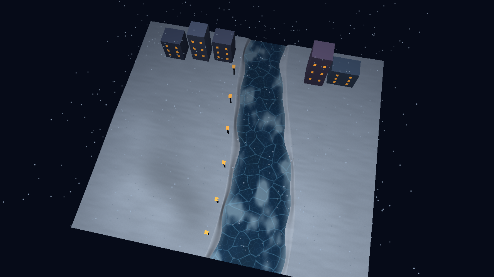
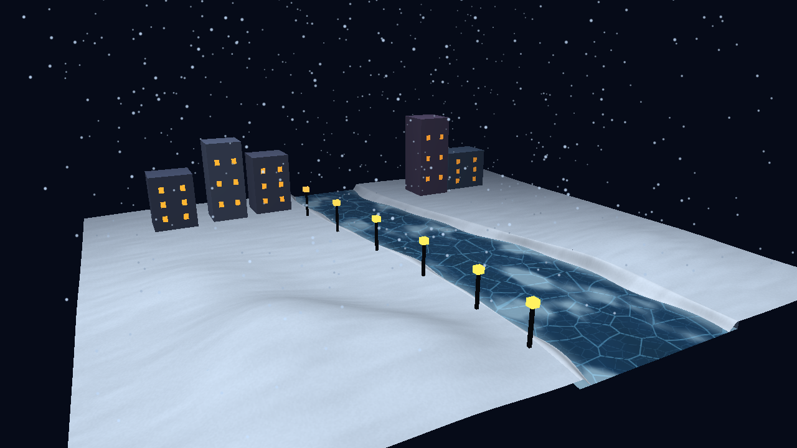

# Member 4 - frozen river and riverbanks

## Completed work

The existing starter river and banks have been extended with a subdivided ice surface, smooth snow terrain, correctly lit bank walls, and raised drift ribbons along both shorelines. The ice material has large warped cracks, finer fracture lines, irregular frosted patches, extra frost by the shore, and view-dependent highlights. The ice geometry is static with less than 0.01 units of height variation.

| Responsibility | Result |
| --- | --- |
| Build the river mesh | Curved indexed grid, 128 length segments and 32 across-river subdivisions |
| Build snowy banks | Two terrain grids sharing the river's shoreline, plus vertical bank walls |
| Textured ice with cracks | World-space procedural fractures at two scales, with derivative-based edge filtering |
| Frosted patches | Three-octave value noise, with a separate shoreline frost mask |
| Recognizable from street level and above | Dedicated camera modes and real OpenGL captures of both views |
| Subtle snow variation | Independent irregular drift ribbons on both sides and fine snow grain |

The seven river-related meshes contain 14,577 vertices and 27,136 triangles in total. They are built and uploaded once, with two additional draw calls for the optional snow drifts.

## Files to integrate

| File | Purpose |
| --- | --- |
| `src/River.h`, `src/River.cpp` | CPU geometry and shared bank/river coordinate functions |
| `shaders/scene.frag` | Ice cracks, frost, specular/Fresnel response, and snow grain |
| `src/main.cpp` | Module integration, drift draws, view shortcuts, toggles, capture/check options |
| `CMakeLists.txt` | Compiles `River.cpp` and registers the geometry test |
| `tests/river_geometry_test.cpp` | Checks mesh validity, normals, winding, shoreline seams, and drift clearance |
| `README.md`, `CREDITS.md` | Controls, build/test instructions, contribution record, and AI disclosure |

The namespace is `frozenriver`. Vertices preserve the existing layout: six floats per vertex, `position.xyz` followed by `normal.xyz`. The existing scene vertex shader, mesh upload code, and MVP transformations still consume that layout. Buildings, lamps, and snow particles continue using the existing rendering paths.

If integrating into a newer team version, merge `main.cpp` and `scene.frag` changes with the team's changes. Add `River.cpp` to the executable sources. `uIsSnow` must be set per object and `uShowFrost` once per scene draw. Keep the river in its existing world coordinate space: the frost mask uses the same shoreline formula as `River.cpp`.

## Algorithms to explain

### Geometry and normals

For every longitudinal coordinate `z`, the two shorelines are:

```text
center(z) = 1.75 + 1.30 sin((z + 1.5) * 0.16)
halfWidth(z) = 2.45 + 0.052 (z + 12)
left(z) = center(z) - halfWidth(z)
right(z) = center(z) + halfWidth(z)
```

These retain the starter scene's river shape. Ice, banks, walls, and drift roots use the same sampled coordinates so they meet without gaps. Each grid cell becomes two indexed triangles. For triangle positions `a`, `b`, `c`, the unnormalized face normal is `cross(b-a, c-a)`. Accumulating these at each shared vertex and then normalizing produces area-weighted smooth normals. The two wall windings face inward; top surfaces face up, so back-face culling works correctly.

Snow height combines the original gentle sine variation and Gaussian mounds. A drift is a narrow ribbon that starts exactly at the bank's height and tapers onto the ice. Its width varies along `z`, with different phases on each bank. The blend `t*t*(3-2*t)` makes the transition smooth. The toe is 0.006 units above the ice to avoid overlap flicker.

### Procedural ice texture

The shader uses world `xz` coordinates, giving a consistent pattern scale around the curved river. This is the procedural-shader option of the texturing requirement; there is no sampled bitmap or UV/mipmap claim.

For cracks, the shader searches nearby cells for the closest and second-closest random feature points. Near equal distances, their difference approaches zero, marking a cell boundary. A small coordinate warp distorts the regular cell layout. Two scales produce main fractures and finer lines. `fwidth` estimates how quickly the distance changes across a pixel and smooths very thin lines in distant views.

Frost uses three weighted noise frequencies. A threshold produces uneven pale patches, and distance from the shoreline adds edge frost. Frost blends the ice toward a milky color, softens fracture visibility, and reduces the sharp specular contribution.

The ice's specular term is Blinn-Phong, `max(dot(N, H), 0)^shininess`, where `H` is the normalized sum of the view and light directions. A Fresnel approximation, `0.04 + 0.96*(1-max(dot(N,V),0))^5`, strengthens a blue sky tint at grazing angles. This is a stylized tint, not a reflected scene or cubemap.

## Demonstration

1. Run the application and press **2**. This places the camera 1.6 units above the right bank's snow. Point out the solid ice, wide cracks, frost, and raised drift silhouette.
2. Press **3**. Show the curved river, varied drift widths, and frost distribution from above.
3. Press **F** to compare clear cracked ice with frosted ice; press it again to restore frost.
4. Press **D** to compare the shore with and without the raised snow drifts; restore them afterward.
5. Press **1**, then drag with the left mouse button, scroll, or use the arrow keys to inspect other angles. The title shows shortcuts, toggle states, and FPS.

### Street-level render



### Aerial render



### Overview render



Comparison captures are also included: `screenshots/above-no-frost.png` and `screenshots/above-no-drifts.png`.

## Recorded verification - 8 November 2026

Machine: Apple M1 MacBook Air, 8 GB RAM, macOS 15.0. Compiler: AppleClang 16.0.0. OpenGL driver: `4.1 Metal - 89.3`; all application shaders use GLSL 330 Core. GLFW, GLEW, and GLM remain the only external application libraries.

The machine initially lacked GLM. For this run, GLM 1.0.1 was installed in a local dependency prefix and passed through CMake's `CMAKE_PREFIX_PATH`. On a standard course setup, install GLM alongside GLFW/GLEW as described in the README. The dependency prefix and build output are excluded from the source package.

| Check | Result |
| --- | --- |
| Configure/build with existing warning flags | Passed |
| CTest geometry check | Passed |
| All seven meshes | Finite values, valid indices, nondegenerate triangles, unit normals, and correct winding |
| Shoreline transitions | Bank/wall/drift roots agree; walls reach below ice; drifts remain above ice |
| Framebuffer captures | Five deterministic 1280 x 720 images; no OpenGL errors |
| Material comparisons | Frost toggle changes the river region; drift toggle changes the shoreline region |
| Visual review | Street and aerial views show cracks, frost, and snowy banks; no visible shoreline gaps |

| View | Frames | Resolution | Average FPS |
| --- | ---: | --- | ---: |
| Orbit | 300 | 1280 x 720 | 109.5 |
| Street | 300 | 1280 x 720 | 112.2 |
| Above | 300 | 1280 x 720 | 112.8 |

These short local samples include the application render loop and buffer swaps. They are not long-duration minimum-FPS tests or measurements on the TA machine. Capture runs include disk writes/readback and must not be used for performance claims. Windows and Linux have not been tested in this environment.

To reproduce the checks, use the commands under Verification in `README.md`. Capture mode reads the real back buffer before swapping and writes portable PPM images without adding an image library. The included PNGs are lossless conversions of those captures. The screenshots contain the rendered scene; the live window title, including FPS, should be included when recording the team's demo video.

## AI use

OpenAI Codex assisted with implementation, shader/material work, automated geometry checks, real OpenGL capture and performance checks, and this handoff. This contribution builds on the group's existing Week 7 source. Include the disclosure from the README and describe subsequent personal review or changes in the report.
